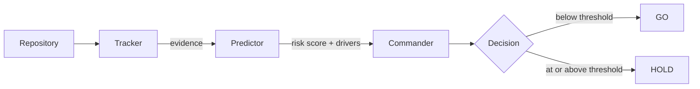

# Triad

**A three-agent release gate: it runs your checks, scores the risk, and returns a clear GO or HOLD for Python and Node repositories, with no API key required.**

---

## Purpose

Deciding whether a full-stack repository is safe to release usually means running tests by hand, skimming linter output, and relying on gut feeling. Triad turns that into a repeatable, CI-friendly decision.

Three agents, each with one responsibility:

| Agent | Role |
|-------|------|
| **Tracker** | Gathers evidence: runs tests, linters, dependency checks, and repository analysis. |
| **Predictor** | Turns that evidence into a risk score and names the main risk drivers. |
| **Commander** | Makes the final **GO** or **HOLD** decision and may apply safe automated fixes. |

## Quick Start

Requires Python 3.10 or newer. The core has no third-party dependencies.

```bash
git clone https://github.com/regann29/Triad.git
cd Triad
pip install -e .

# Evaluate the current repository
triad run . --no-deps --trace
```

**Exit codes**

| Code | Meaning |
|------|---------|
| `0` | GO: the repository is ready to release. <!-- TODO: confirm --> |
| `1` | HOLD: release blocked. <!-- TODO: confirm --> |
| `2` | Error: Triad could not complete the evaluation. <!-- TODO: confirm --> |

## Example Output

```text
<!-- TODO: paste a real run of `triad run . --no-deps --trace` here -->
```

## Architecture



| Agent | Inputs | Decisions | Tools |
|-------|--------|-----------|-------|
| **Tracker** | Repository path, detected stack (Python / Node) | Which checks apply to this repo | Test runner, linters, dependency checks, repository analysis |
| **Predictor** | Tracker's evidence | Overall risk score and the top risk drivers | Risk scoring logic |
| **Commander** | Risk score, drivers, configured threshold | GO or HOLD; whether a safe fix may be applied | Safe auto-fix actions |

## Configuration

Everything is optional. Export these in your shell (see [`.env.example`](.env.example)).

| Variable | Default | Description |
|----------|---------|-------------|
| `TRIAD_RISK_THRESHOLD` | `0.35` | Risk score at which Commander returns HOLD. |
| `TRIAD_LLM` | `offline` | `offline` or `anthropic`. |
| `TRIAD_MODEL` | `claude-sonnet-5` | Model used when `TRIAD_LLM=anthropic`. |
| `ANTHROPIC_API_KEY` | _(empty)_ | Only needed for the Anthropic backend. |

**Risk formula**

```text
<!-- TODO: paste the real formula and weights, e.g.
risk = w_tests * test_failures + w_lint * lint_issues + w_deps * dependency_risk + ... -->
```

## Safety

Triad is designed to be conservative about anything that changes your code.

- **Dry-run enforced:** automatic actions respect dry-run mode. <!-- TODO: name the flag and where it is enforced -->
- **Blocked tools:** Commander cannot call tools outside its allow-list. <!-- TODO: list blocked tools -->
- **No auto-fixing failing tests:** a failing test always produces a HOLD. Triad never edits code or tests to make a failure disappear.

## Optional Features

- **LLM backend.** Set `TRIAD_LLM=anthropic` and provide `ANTHROPIC_API_KEY` to enable LLM assistance.

  ```bash
  pip install -e ".[anthropic]"
  export TRIAD_LLM=anthropic
  export ANTHROPIC_API_KEY=your-key
  ```

  Without it, all three agents run fully offline.

## Extending

<!-- TODO: replace with snippets that match the real agent/tool interfaces -->

**Add a tool**

```python
# src/triad/... (TODO)
```

**Add an agent**

```python
# src/triad/... (TODO)
```

## Project Layout

```text
.
├── .github/workflows/   # CI configuration
├── src/triad/           # Tracker, Predictor, Commander, and the CLI
├── tests/               # Test suite
├── .env.example         # Optional environment variables
├── Makefile             # install, test, lint, fmt, run shortcuts
├── pyproject.toml       # Packaging, dependencies, pytest and ruff config
└── README.md
```

## Development

```bash
make install   # pip install -e ".[dev]"
make test      # pytest
make lint      # ruff check .
make fmt       # ruff check --fix . && ruff format .
make run       # triad run . --no-deps --trace
```

## Known Limits

- **Supported stacks:** Python and Node repositories.
- **Python version:** 3.10 or newer.
- **Platforms:** <!-- TODO: state tested OS list -->
- **Untested paths:** <!-- TODO -->
- **Network:** the core runs offline; only the optional Anthropic backend needs network access, and any dependency checks that query registries may too. <!-- TODO: confirm -->

## License

Released under the terms in the [LICENSE](LICENSE) file.
